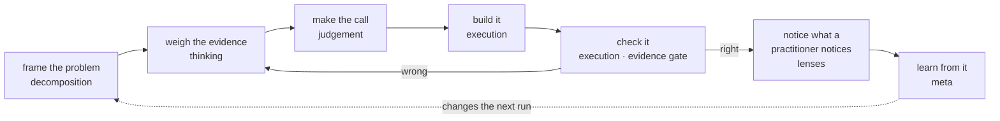

# Roadmap

Build order matters more than build volume. Every corpus we studied acquired a sediment layer by
writing breadth before fixing the standard (sickn33/agentic-awesome-skills, mattpocock/skills). So
the order below is driven by one question: **what must exist before the next thing can be tested?**

The answer is a spine, not a catalogue. Eight skills that make the loop below work, then breadth.

---

## The loop the library has to close

Two properties of this loop drive the roadmap:

1. **Every node is loadable on its own.** No skill requires another to exist; a missing neighbour
   degrades output, it does not break the skill. That is what makes the library composable instead of
   a framework.
2. **The loop closes on a checkable artifact, not a reflection.** `meta` must emit something a machine
   can hold — a gotcha line, a lint rule, a test, a superseded memory entry. An open loop is the
   defect every corpus we read has (mattpocock/skills, sickn33's corpus).

---

## Phase 1 — the spine (8 skills)

These are the ones that must be excellent before anything else is written, because every later skill
is written *using* them. If phase 1 is wrong, phase 2 multiplies the error.

| # | skill | domain | invocation | the intervention | why it is in phase 1 |
|---|---|---|---|---|---|
| 1 | `frame-the-problem` | decomposition | model | decide what kind of problem this is *before* decomposing it — sub-questions by epistemic status, not tasks | the thing no corpus does; everything downstream inherits its framing (our own survey of the skills.sh marketplace) |
| 2 | `weigh-evidence` | thinking | model | test a claim before acting on it: two-hypothesis discipline, IS/IS-NOT bounding, reversal test, base rates | the most-copied pattern in the landscape, and the least well-specified |
| 3 | `make-the-call` | judgement | model | produce a decision with its cost, reversibility, and what would change it | the emptiest category in the market; adjacent to its most-installed skills |
| 4 | `split-by-frontier` | decomposition | model | task graph, frontier, fog of war, tracer slices, out-of-scope as a permanent bucket | the best-evidenced decomposition method observed (mattpocock/skills) |
| 5 | `red-green` | execution | model | no production change without a failing test first; the rationalization table is the skill | the discipline skill with the strongest measured evidence in the ecosystem |
| 6 | `prove-it` | execution | model | no completion claim without a command run in this turn; read the output, then speak | the single most-copied pattern in 3,055 skills; cheap, universal, immediately valuable |
| 7 | `run-autonomously` | orchestration | user | the loop contract: disk as memory, fresh context, byte-exact sentinel, retry→skip→abort, brakes | the only skill that lets the rest run unattended; needs 1–6 to be safe |
| 8 | `learn-from-correction` | meta | model | turn a correction into a durable artifact, classified mechanical (build a check) vs judgement (write a standard) | closes the loop; without it the library is a static document |

**Phase 1 exit test:** a greenfield feature built end to end with only these eight loaded, and the
transcript shows every gate firing. If a gate does not fire, the skill is wrong, not the agent.

---

## Phase 2 — the lenses (6 skills)

Lenses are what make the library *feel* senior. Each is written to the four-part recipe in
`TAXONOMY.md` §2 (`lenses/`): locked vocabulary, rejection list, a decision procedure with a hard zero
tier, exact values.

| # | skill | the discipline | its zero tier |
|---|---|---|---|
| 9 | `judge-architecture` | module shape, seams, depth, leverage (Ousterhout, read properly) | "no new abstraction" is a valid verdict |
| 10 | `judge-risk` | security: trust boundaries, injection surfaces, secret handling, blast radius | "this does not need a threat model" |
| 11 | `judge-performance` | frame budgets, allocation, hot paths, measurement before optimisation | "do not optimise this" |
| 12 | `judge-taste` | UI/interaction craft: motion, hierarchy, restraint | `ship` — the hierarchy holds, nothing to strip |
| 13 | `judge-data` | schema shape, migration safety, invariants, reversibility | "do not add a column" |
| 14 | `judge-api` | surface design, naming, error contracts, versioning, evolvability | "do not add this endpoint" |

Each lens ships a `references/` value table and a review output contract (a verdict enum, not prose).
A lens with no rejection list is a mood board, not a lens.

---

## Phase 3 — the human interface (4 skills)

| # | skill | domain | the intervention |
|---|---|---|---|
| 15 | `ask-better` | interface | frontier-and-rounds interviewing: one question at a time, a recommended answer each, facts are the agent's job |
| 16 | `report-with-evidence` | interface | the output contract for a claim: what was run, what it showed, confidence, what remains unknown |
| 17 | `disagree-well` | interface | refuse to certify the uncertifiable without manufacturing disagreement; the paired-prohibition form |
| 18 | `write-handoff` | interface | the artifact that survives a context boundary: decisions, state, next action, pointers not copies |

---

## Phase 4 — autonomy depth (5 skills)

| # | skill | domain | invocation | the intervention |
|---|---|---|---|---|
| 19 | `dispatch-workers` | orchestration | model | bounded delegation contracts: status enum, report-to-file, under-N-lines returns |
| 20 | `parallel-safely` | orchestration | model | non-overlapping ownership, worktrees, a serialised merge, a coordinator that verifies |
| 21 | `budget-the-run` | orchestration | model | per-run cost and time budgets, and the escalation threshold that ends a run |
| 22 | `stop-or-escalate` | orchestration | model | the four-stop boundary: done, blocked, wrong, out of budget |
| 23 | `manage-context` | meta | model | compaction, handoff, fork: what to keep, what to drop, what to re-read |

Phase 4 disciplines are all `invocation: model` — they are loaded mid-run by whatever carries the
loop. Only the run-starter (`run-autonomously`) is `invocation: user`; a user-invoked skill cannot be
reached by another skill, so making a discipline user-invoked would make `autonomous-run` unloadable
(`AUTHORING-STANDARD.md` §4). `manage-context` sits in `meta/`, not `orchestration/`: its output is a
change to the agent's own operating state, which is the `meta` admission test (`TAXONOMY.md` §2).

---

## Phase 5 — breadth, on demand

Everything else is written when a real failure demands it, in this order of evidence:

1. **A correction that recurred** → `learn-from-correction` produced a candidate.
2. **A gap a lens exposes** → the lens's "not covered here" line.
3. **A pack that cannot be assembled** → the missing skill the pack needs.

**No speculative skills.** A skill with no observed baseline failure is a hypothesis, and hypotheses
belong in an issue, not in `skills/` (mattpocock/skills).

### Phase 5 — commissioned breadth, first wave (11 skills)

Commissioned by user request, not by the three evidence triggers above — so every baseline in this
wave is a labelled **hypothesis**, not an observed failure: each case in `evals/behaviour.md` opens
`Baseline (hypothesis — unverified)` until a capture run exists, and any of those baselines can be
challenged on that basis. Each skill needs one observed trigger (a live baseline run, a recurring
correction, or a pack that cannot assemble without it) before it counts toward the M5 gate.

| skill | domain | the intervention it lands |
|---|---|---|
| `debug-systematically` | execution | reproduce → isolate → mechanism → fix → verify; no fix until the failure reproduces on demand |
| `read-before-write` | execution | every caller named and the contract read before the first edit |
| `migrate-safely` | execution | expand → shadow on real inputs → cutover → contract; never the big-bang rewrite |
| `commit-atomically` | execution | one commit, one reason — the revert takes that reason and nothing else |
| `premortem` | thinking | the obituary before the work; every cause gets mitigate / tripwire / accept with an owner |
| `trace-second-order` | thinking | every change priced by what it incentivizes, makes easier to break, costs at 10×, and forecloses |
| `judge-tests` | lenses | test quality as a verdict — a green suite that asserts nothing is the target failure |
| `judge-reliability` | lenses | the failing operation plus what the caller sees when it fails — happy-path review is the defect |
| `judge-cost` | lenses | pricing vocabulary only: tokens, retries, billed calls, context bytes — latency stays with `judge-performance` |
| `explain-at-level` | interface | the answer at the listener's altitude — one entry point, one load-bearing concept |
| `write-a-skill` | meta | this library's own standard operationalized; no skill without a recorded failure |

---

## What we deliberately do not build

| not building | why |
|---|---|
| vendor/API reference skills | they are documentation; the VoltAgent index already carries 133 Microsoft ones |
| per-tool wrappers (`*-delegate` for every CLI) | mechanical variation on a template inflates a category without adding capability (sickn33's corpus) |
| a "persona" skill that says "you are a senior engineer" | persona is a lexicon plus a rejection list, not a job title (Anthropic's best-practices doc) |
| a scoring rubric we cannot compute | a decorative rubric is worse than none (sickn33's corpus) |
| a 10k catalogue | the browseable unit is the pack, and packs need 40 good skills, not 10k |

---

## Milestones

| milestone | definition of done | gate |
|---|---|---|
| M1 | the standard, the taxonomy, the template, the validator exist | validator passes on a fixture corpus and rejects each known defect |
| M2 | phase 1 complete | the eight skills pass review; the end-to-end exit test runs |
| M3 | phase 2 complete | a review-desk session using three lenses produces a verdict a senior engineer would sign |
| M4 | phases 1–4 complete | an unattended run of ≥2 hours completes a real task without a human |
| M5 | published: packs render, docs generate from data, evals run in CI | not met — docs generate from data and the index drift check runs in CI; the eval sets are recorded and reviewed but not executed, because the repo ships no eval runner |

The M5 gate is not met and must not be read as met: the repo ships no eval runner, so nothing under
`evals/` executes in CI. The sets are recorded and reviewed by hand.

---

## Build order, in one line

**Standard → spine → lenses → interface → autonomy → breadth.** Never breadth first. Every corpus we
studied that inverted this order is now a keyword index.
